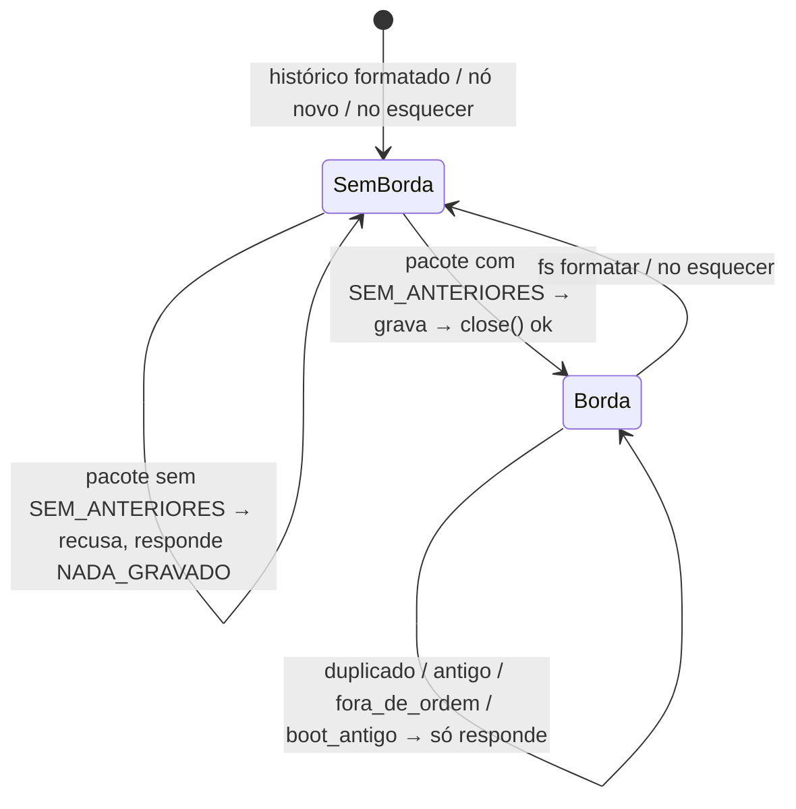

# Protocolo de aplicação nó → coordenador

Formato dos bytes trocados entre o nó sensor e o coordenador pelo ESP-NOW (Etapa 3; autenticação na revisão do parecer da ERRC; confirmação e reenvio na Etapa 7.1). Definido uma única vez em [`comum/protocolo/src/protocolo.h`](../comum/protocolo/src/protocolo.h), incluído pelos dois firmwares; testado sem rádio no PC (`cd no_sensor && pio test -e native`).

**Versão 3 (Etapa 7.1): `PacoteAssinado`, 42 bytes = `PacoteLeitura` (26 bytes, binário, little-endian, `versao = 3`) + assinatura HMAC-SHA256 de 16 bytes (seção 12).** Em relação à v2 (38 B), a v3 acrescenta a idade da leitura (`idade_s`, 4 B no fim) e o bit `SEM_ANTERIORES`, e cria a mensagem de volta, a **confirmação** (25 B, coordenador → nó, seção 13). As versões 1 (22 B, sem assinatura) e 2 (38 B, sem idade) são recusadas pelo coordenador (`versao_desconhecida`).


## 1. Decisões e justificativas

| Decisão | Escolha | Por quê |
|---|---|---|
| Codificação | binário de tamanho fixo (`struct` packed) | a 1 Mbps cada byte custa 8 µs no ar e energia do nó; o JSON fica para a API HTTP do coordenador (seção 9) |
| Números | inteiros escalados, sem `float` | 2 bytes no lugar de 4, sem `NaN`, comparação exata; ×100 dá 0,01 °C, a resolução do AHT20 |
| Identificação do nó | **MAC de origem** (sem campo de id) | o callback de recepção já entrega o `src_addr`; todos os nós usam o mesmo binário; o coordenador mantém a tabela MAC → nome e calibração |
| Sequência | `seq` uint32 na RAM do RTC + `boot` uint16 na NVS | o par (`boot`, `seq`) nunca se repete; separa perda, duplicata e reinício (seção 6) |
| Umidade do solo | **tensão em mV**; o % é calculado no coordenador | recalibrar no campo sem regravar os nós; o histórico guarda o dado bruto |
| Estados | 2 bits por grandeza, num único byte | `ok`, `erro`, `fora_de_faixa` (+1 valor reservado) |
| Instrumentação | tempo acordado e tentativas do ciclo anterior, motivo do boot, flags | consumo, taxa de entrega e diagnóstico em campo por 5 bytes (40 µs no ar) |
| Checksum próprio | **nenhum** | o quadro 802.11 já tem FCS (CRC-32); estrutura conferida por versão, tamanho e faixas |
| Autenticidade (v2) | **HMAC-SHA256 truncado em 16 B**, chave derivada por nó; sem a criptografia nativa (CCMP) | a CCMP sozinha não impede um quadro sem cifra com MAC forjado (teste E4, `docs/auditoria_errc.md`) e limita o coordenador a 7 peers cifrados; seção 12 |
| Horário | **não vai no pacote**; vai a **idade** da leitura (v3) | o nó não tem relógio de calendário; o coordenador marca a hora da recepção, e a hora da leitura é a recepção menos a idade (leituras reenviadas, seção 13). Os campos de tempo são durações medidas pelo nó |
| Confirmação (v3) | **cumulativa, assinada, enviada antes de gravar** | "tudo até (boot, seq) está gravado"; o nó guarda cada leitura até ela ser confirmada (seção 13) |

## 2. Conceitos e fontes

- **Tipos de tamanho fixo** (`<cstdint>`): `long` tem 4 bytes no ESP32 e 8 no PC x86-64 (medido com `static_assert` nos dois compiladores), então o pacote usa só `uint8_t`, `int16_t`, `uint16_t` e `uint32_t`.
- **Padding e `packed`:** sem `packed`, o compilador insere bytes de alinhamento. O GCC define que o atributo faz cada membro ser *"placed to minimize the memory required"* ([GCC, Common Attributes](https://gcc.gnu.org/onlinedocs/gcc/Common-Attributes.html)). A ordem dos campos foi escolhida para que todos fiquem **naturalmente alinhados** (cada campo de *n* bytes num offset múltiplo de *n*): não há enchimento interno, e sem `packed` o compilador acrescentaria só 2 bytes no fim (24 bytes), o que o `static_assert` detecta.
- **Acesso desalinhado:** no ESP32, uma leitura de 16/32 bits num endereço desalinhado gera a exceção *LoadStoreAlignment* ([ESP-IDF, Fatal Errors](https://docs.espressif.com/projects/esp-idf/en/v5.5/esp32/api-guides/fatal-errors.html)). Regras: nunca pegar ponteiro para um campo do pacote; o pacote recebido é copiado com `memcpy` para uma variável local (`validar()`).
- **Endianness:** o ESP32 é little-endian (`XCHAL_HAVE_BE 0` em `xtensa/config/core-isa.h`; o `xtensa-esp32-elf-gcc` define `__XTENSA_EL__`), assim como o PC dos testes. **Todos os campos multibyte são little-endian.** Para ler o pacote v3 em Python: `struct.unpack('<BBHIhHHHBBHBBI', dados[:26])`.
- **Carga máxima do ESP-NOW v1.0:** 250 bytes ([ESP-NOW, ESP-IDF v5.5](https://docs.espressif.com/projects/esp-idf/en/v5.5/esp32/api-reference/network/esp_now.html)), travada por `static_assert`.

## 3. Campos

| Offset | Campo | Tipo | Bytes | Unidade / escala | Faixa válida |
|---|---|---|---|---|---|
| 0 | `versao` | uint8 | 1 | — | = 3 |
| 1 | `tipo` | uint8 | 1 | 1 = leitura | = 1 |
| 2 | `boot` | uint16 | 2 | contador de boots do nó (NVS) | 0–65535 (dá a volta) |
| 4 | `seq` | uint32 | 4 | nº do pacote no boot; o 1º é 0 | 0–4 294 967 295 (dá a volta) |
| 8 | `temperatura_c100` | int16 | 2 | 0,01 °C | −4000 a 8500 (−40 a 85 °C, AHT20 tab. 2) |
| 10 | `umidade_ar_c100` | uint16 | 2 | 0,01 %UR | 0 a 10000 (AHT20 tab. 1) |
| 12 | `solo_mv` | uint16 | 2 | mV na saída do sensor | 0 a 3300 |
| 14 | `alimentacao_mv` | uint16 | 2 | mV na entrada do divisor | 0 a 6000 |
| 16 | `estados` | uint8 | 1 | 2 bits por grandeza | sem o valor 3 |
| 17 | `motivo_boot` | uint8 | 1 | `esp_reset_reason()` | 0–15 no ESP-IDF 5.5 (outros aceitos) |
| 18 | `acordado_ant_ms` | uint16 | 2 | ms acordado no ciclo anterior | 0 = desconhecido |
| 20 | `tentativas_ant` | uint8 | 1 | envios (`esp_now_send`) do pacote anterior | 0 = desconhecido |
| 21 | `flags` | uint8 | 1 | bit 0: o AHT20 precisou de nova tentativa; bit 1: o pacote anterior esgotou as tentativas sem ACK (`ANTERIOR_SEM_ACK`, Etapa 4); bit 2: o prazo máximo acordado interrompeu o ciclo anterior (`CICLO_ANTERIOR_ABORTADO`, Etapa 5); bit 3: o nó não tem leitura pendente anterior a esta (`SEM_ANTERIORES`, v3, seção 13); bits 4–7 reservados (enviados como 0, ignorados) | — |
| 22 | `idade_s` | uint32 | 4 | s entre a leitura e o envio (v3); 0 = enviada no ciclo em que foi lida. Fora do alinhamento natural: ler só por cópia | — |
| | **total** | | **26** | | |

**Campo `estados`:**

```
bit:    7  6 |  5  4 |  3  2 |  1  0
     alimentação | solo | umidade ar | temperatura

00 = ok   01 = erro (valor enviado como 0, ignorar)   10 = fora_de_faixa   11 = reservado (inválido)
```

**`motivo_boot`** ([ESP-IDF, misc system API](https://docs.espressif.com/projects/esp-idf/en/v5.5/esp32/api-reference/system/misc_system_api.html)): 1 = `POWERON` (no ESP32 inclui o reset pelo pino EN), 3 = `SW`, 4 = `PANIC`, 5–7 = watchdogs, 8 = `DEEPSLEEP`, 9 = `BROWNOUT` (bateria fraca), 14 = `PWR_GLITCH`, 15 = `CPU_LOCKUP`.

**`tentativas_ant` e `ANTERIOR_SEM_ACK`** (definidos na Etapa 4, [`comunicacao.md`](comunicacao.md)): `tentativas_ant` conta quantas vezes o nó chamou `esp_now_send` para o pacote anterior. Sozinho, o valor máximo seria ambíguo (entregue na última tentativa ou desistiu?); o bit `ANTERIOR_SEM_ACK` de `flags` diz que nenhuma tentativa recebeu o ACK da camada MAC. Cruzado com o `seq` no coordenador, separa a falha no rádio (bit ligado, `seq` anterior ausente) da perda depois do ACK (bit desligado, `seq` anterior ausente: fila ou validação no coordenador). Usar um bit até então reservado não muda a `VERSAO`: coordenadores anteriores já o ignoravam. Ambos valem 0 no primeiro pacote depois de ligar (a RAM do RTC zera no *power-on*).

### Exemplo real (NÓ 1, 05/10/2026, protocolo v1), conferido com a linha CSV do mesmo ciclo

Os 22 primeiros bytes têm o mesmo layout desde a v1; a v3 só acrescenta `idade_s` depois deles.

```
01 01 04 00 00 00 00 00 26 08 C5 17 F9 03 35 0D 00 01 00 00 00 00
```

| Offset | Bytes | Campo | Valor | Leitura do ciclo |
|---|---|---|---|---|
| 0 | `01` | versao | 1 | — |
| 1 | `01` | tipo | leitura | — |
| 2 | `04 00` | boot | 4 | — |
| 4 | `00 00 00 00` | seq | 0 | — |
| 8 | `26 08` | temperatura | 0x0826 = 2086 → 20,86 °C | 20,86 °C |
| 10 | `C5 17` | umidade_ar | 0x17C5 = 6085 → 60,85 % | 60,85 % |
| 12 | `F9 03` | solo | 0x03F9 = 1017 mV | 1017,0 mV |
| 14 | `35 0D` | alimentação | 0x0D35 = 3381 mV | 3381 mV |
| 16 | `00` | estados | todos ok | todos ok |
| 17 | `01` | motivo_boot | POWERON | — |
| 18 | `00 00` | acordado_ant_ms | desconhecido (sem deep sleep ainda) | — |
| 20 | `00` | tentativas_ant | desconhecido (sem rádio ainda) | — |
| 21 | `00` | flags | — | aht20_extras = 0 |

## 4. Montagem no nó (`montarLeitura`)

Recebe as leituras em unidades naturais (como saem de `sensores::lerTodas()`) e:

1. multiplica pela escala e arredonda para o inteiro mais próximo (meio para longe do zero);
2. verifica a faixa válida **antes** de saturar: com estado `ok` e valor fora da faixa, o estado passa a `fora_de_faixa` (ex.: −1 % é saturado em 0 e continua fora de faixa);
3. satura no limite do tipo o que não couber (ex.: 400 °C → 32767);
4. estado `erro`, valor `NaN` ou estado `reservado` na entrada → valor 0 e estado `erro`.

Contadores no nó ([`no_sensor/src/contadores.cpp`](../no_sensor/src/contadores.cpp)):

- `boot`: lido e incrementado na NVS (biblioteca `Preferences`, [Arduino-ESP32](https://docs.espressif.com/projects/arduino-esp32/en/latest/api/preferences.html)) em todo início que **não** seja o despertar do deep sleep. Uma escrita na flash por boot, nunca por ciclo; a NVS tem distribuição de desgaste própria ([NVS, ESP-IDF](https://docs.espressif.com/projects/esp-idf/en/v5.5/esp32/api-reference/storage/nvs_flash.html)).
- `seq`: em `RTC_DATA_ATTR`, que *"will keep its value during a deep sleep / wake cycle"* (`esp_attr.h`, ESP-IDF 5.5) e volta a 0 em qualquer outro reset.

## 5. Validação no coordenador (`validar`)

Verificações, nesta ordem; a primeira que falhar define o motivo, e o pacote é descartado e registrado.

| # | Verificação | Motivo registrado |
|---|---|---|
| 1 | ponteiro nulo ou menos de 2 bytes | `tamanho_curto` |
| 2 | `versao` ≠ 3 | `versao_desconhecida` |
| 3 | `tipo` ≠ 1 | `tipo_desconhecido` (inclusive uma confirmação refletida, tipo 2) |
| 4 | tamanho ≠ 42 (`PacoteAssinado`) | `tamanho_errado` |
| 5 | HMAC dos bytes 0–25 com a chave do nó de origem ≠ bytes 26–41 (seção 12) | `assinatura_invalida` |
| 6 | algum estado = 3 | `estado_reservado` |
| 7 | estado `ok` com valor fora da faixa (seção 3) | `temperatura_fora`, `umidade_ar_fora`, `solo_fora`, `alimentacao_fora` |

- Versão e tipo vêm antes do tamanho exato: um nó com firmware novo (outra versão, outro tamanho) aparece como `versao_desconhecida`, o diagnóstico útil.
- A assinatura vem antes do conteúdo: nada de um pacote não autenticado é interpretado.
- Valores com estado `fora_de_faixa` ou `erro` não são verificados (o nó já os marcou).
- Bits reservados de `flags` e valores desconhecidos de `motivo_boot` são **aceitos**, para compatibilidade com versões futuras.

## 6. Sequência, duplicatas e reinício (`RastreadorSequencia`)

Um rastreador por nó (MAC) no coordenador classifica cada pacote autêntico pelo par (`boot`, `seq`) contra a **borda**: o último par **gravado** daquele nó. Desde a v3 (Etapa 7.1), a classificação não move a borda; ela só avança depois que o registro foi gravado (`classificar()` → gravar → `confirmar()`). E só o **próximo** par é aceito: um buraco só passa se o nó declarar, pelo bit `SEM_ANTERIORES`, que não tem nada anterior guardado. Assim o histórico de cada nó fica contínuo, e a confirmação cumulativa "tudo até a borda" é sempre verdadeira (seção 13).

| Situação | Classe | Grava? |
|---|---|---|
| sem borda (histórico do nó desconhecido) e `SEM_ANTERIORES` | `primeiro` | sim |
| sem borda e sem `SEM_ANTERIORES` (o nó ainda tem leituras anteriores) | `fora_de_ordem` | não |
| mesmo `boot`, `seq` = borda + 1 | `novo` | sim |
| mesmo `boot`, `seq` > borda + 1, com `SEM_ANTERIORES` | `novo`; `seq − borda − 1` **perdidos** (descartados no próprio nó) | sim |
| mesmo `boot`, `seq` > borda + 1, sem `SEM_ANTERIORES` | `fora_de_ordem` | não |
| mesmo `boot` e mesmo `seq` | `duplicado` | não |
| mesmo `boot`, `seq` anterior à borda | `antigo` | não |
| `boot` posterior, com `SEM_ANTERIORES` | `reinicio`; os `seq` anteriores a este no boot novo contam como perdidos | sim |
| `boot` posterior, sem `SEM_ANTERIORES` (fila do boot anterior ainda no nó) | `fora_de_ordem` | não |
| `boot` anterior à borda | `boot_antigo` | não |

Todos os pacotes autênticos recebem a confirmação, inclusive os recusados: é ela que diz ao nó de onde reenviar.

- **Volta dos contadores:** as comparações usam aritmética modular (como o RFC 1982): `seq` em 32 bits (depois de 0xFFFFFFFF vem 0) e `boot` em 16 bits (depois de 65535 vem 0). A 1 pacote por minuto, a volta do `seq` levaria ~8000 anos; os testes existem por correção.
- **Por que "boot anterior" é descartado (v2):** com a assinatura, um pacote **autêntico** de um boot antigo, repetido, passaria como reinício. O boot só pode avançar. Se a NVS de um nó for apagada (o contador recomeça), o coordenador recusa o nó até alguém liberá-lo (`no esquecer`, no console).
- **Coordenador religado:** `restaurar(boot, seq)` retoma a borda do último registro do nó no histórico. Um pacote recebido e não gravado (queda antes do `close()`) volta a ser aceito no reenvio.
- **Gravação que falhou:** a borda não avança; o reenvio do mesmo pacote é aceito.
- **Limitação:** perdas no fim de um boot (antes de o nó reiniciar) não são detectáveis.
- **Taxa de entrega** (avaliação): `aceitos / (aceitos + perdidos)` por nó. Com a fila, os perdidos são só as leituras que o próprio nó descartou (fila cheia, ou fila perdida num reinício).

## 7. Umidade do solo no coordenador

O coordenador guarda, por MAC, os pontos de calibração (`mv_seco`, `mv_umido`) e calcula `% = (mv_seco − mv) / (mv_seco − mv_umido) × 100`, limitado a 0–100. Valores de bancada: 1400 e 655 mV ([`sensores.md`](sensores.md), seção 4.3). Sem calibração cadastrada para um nó, mostra só a tensão.

## 8. Integridade

- Todo quadro 802.11 termina com o **FCS (CRC-32)**, que aparece no formato do quadro ESP-NOW na documentação da Espressif. Pelo padrão IEEE 802.11, o receptor descarta quadros com FCS inválido antes de entregá-los ao software.
- O ESP-NOW não acrescenta outro CRC na parte do fabricante.
- Um checksum próprio só detectaria erros introduzidos depois da recepção (bugs); contra isso existem a versão, o tamanho exato e a validação de faixas. Contra adulteração e falsificação, a proteção é a assinatura HMAC da v2 (seção 12), e não um checksum.

## 9. Overhead no ar

**Quadro ESP-NOW v1.0** ([ESP-IDF v5.5, Frame Format](https://docs.espressif.com/projects/esp-idf/en/v5.5/esp32/api-reference/network/esp_now.html)):

```
| cabeçalho MAC | categoria | OUI | aleatório | elemento do fabricante          | FCS |
|      24       |     1     |  3  |     4     | ID 1, comp. 1, OUI 3, tipo 1,   |  4  |
|               |           |     |           | versão 1, corpo = carga útil    |     |
                         → 43 bytes fixos + carga útil
```

**Camada física:** taxa padrão do ESP-NOW de 1 Mbps (`WIFI_PHY_RATE_1M_L`, *"1 Mbps with long preamble"*); preâmbulo longo + cabeçalho PLCP = 192 µs (IEEE 802.11, camada DSSS). Tempo no ar = 192 µs + 8 µs por byte do quadro.

**Energia:** corrente típica de transmissão 802.11b DSSS 1 Mbps a +19,5 dBm = 240 mA (ESP32 Series Datasheet v5.3, tab. 5-4). Carga do rádio = 240 mA × tempo no ar.

| Formato (mesmo conteúdo) | Carga útil | Quadro | Tempo no ar | Carga do rádio | Carga útil / quadro | Cabe no ESP-NOW v1? |
|---|---|---|---|---|---|---|
| **Binário (`PacoteLeitura`)** | **22 B** | **65 B** | **712 µs** | **171 µC** | 34 % | sim |
| JSON compacto (`{"v":1,"t":1,…}`) | 93 B | 136 B | 1280 µs | 307 µC | 68 % | sim |
| JSON legível (`{"versao":1,…}`) | 273 B | 316 B | 2720 µs | 653 µC | 86 % | **não** |
| JSON compacto, pior caso | 117 B | 160 B | 1472 µs | 353 µC | 73 % | sim |
| JSON legível, pior caso | 339 B | 382 B | 3248 µs | 780 µC | 89 % | **não** |


Leitura dos resultados:

1. **O binário transmite em 712 µs, 1,8× mais rápido que o JSON compacto e 3,8× mais rápido que o JSON legível**, com a mesma informação. O JSON legível nem cabe no limite de 250 bytes do ESP-NOW v1.
2. A eficiência do binário (34 %) parece baixa porque **o custo fixo domina**: o preâmbulo (192 µs) e os 43 bytes de cabeçalho (344 µs) somam 536 µs, 75 % do tempo do quadro. Por isso cortar mais 2 ou 3 bytes da carga útil não valeria a perda de clareza.
3. A transmissão confirmada inclui o ACK do coordenador (14 bytes: 304 µs) após o SIFS (10 µs): **~1026 µs por pacote entregue**, sem contar a espera de acesso ao canal (DIFS e backoff aleatório).
4. Por ciclo, o rádio gasta ~0,17 mC transmitindo o pacote. É pouco perto do tempo que o rádio fica ligado para iniciar o Wi-Fi e esperar o ACK; o consumo total por ciclo será medido na etapa 5.

Script: [`ferramentas/overhead_protocolo.py`](../ferramentas/overhead_protocolo.py) (gera a tabela e as duas figuras).

## 10. Testes

`cd no_sensor && pio test -e native`: **58 testes Unity no PC** ([Unity no PlatformIO](https://docs.platformio.org/en/latest/advanced/unit-testing/frameworks/unity.html)): 49 do protocolo em [`no_sensor/test/test_protocolo/`](../no_sensor/test/test_protocolo/test_main.cpp) e 9 da fila do nó em [`no_sensor/test/test_fila/`](../no_sensor/test/test_fila/test_main.cpp).

| Grupo | O que cobre |
|---|---|
| Layout | tamanhos de 26, 42, 9 e 25 bytes; os 26 bytes esperados, em little-endian, de um pacote montado (com `idade_s`) |
| Montagem | bits de estado; limites exatos das faixas (−40,00 e 85,00 °C) e um passo além; saturação; umidade negativa; `erro`, `NaN`, `reservado` e infinito |
| Validação | ida e volta montar → validar; buffer em endereço ímpar; tamanho curto, versão desconhecida (inclusive com outro tamanho), pacotes v1 e v2 recusados, tipo desconhecido, tamanho errado, estado reservado, cada faixa com estado `ok`; valores aceitos com `fora_de_faixa`/`erro`; flags e motivo desconhecidos aceitos; bits `ANTERIOR_SEM_ACK`, `CICLO_ANTERIOR_ABORTADO` e `SEM_ANTERIORES` |
| Assinatura | assinatura = 16 primeiros bytes do HMAC; chave errada; cada bit dos bytes 2–41 alterado; idade adulterada; assinatura conferida antes do conteúdo; falha do HMAC; chave derivada depende do MAC e da mestra |
| Confirmação (v3) | ida e volta; chave errada (forjada); cada bit alterado; reflexão nos dois sentidos; versão e tamanho; além do último par gerado; `NADA_GRAVADO`; comparação modular de pares |
| Sequência (v3) | só o próximo; buraco declarado por `SEM_ANTERIORES`; sem borda só aceita a mais antiga; duplicado e antigo; gravação que falhou não move a borda; reinício do nó exige `SEM_ANTERIORES`; volta do boot; boot antigo; `restaurar` com o pacote não gravado; `esquecer`; estouro do `seq` |
| Fila do nó | entrada de 26 B; ordem; fila cheia descarta a mais antiga; liberação cumulativa (antiga, repetida, além do fim); boots diferentes; volta do anel; estado só na memória recebida; controle incoerente; idade e `SEM_ANTERIORES` no envio |

Na placa: `cd no_sensor && pio test -e esp32doit-devkit-v1 -f test_hmac_esp32` (HMAC-SHA256 do mbedTLS contra a RFC 4231 e tempo de assinar/validar; seção 12).

## 11. Evolução

Qualquer mudança de campo, tamanho ou significado exige **incrementar `VERSAO`** e atualizar este documento, os `static_assert` e os testes. Um coordenador antigo descarta pacotes de versão nova com o motivo `versao_desconhecida`, em vez de interpretar bytes errados. Tipos novos de mensagem (ex.: "nó iniciou") usam o campo `tipo`, com structs próprias que começam pelos mesmos dois bytes (`versao`, `tipo`).

## 12. Autenticação (v2; v3 igual, com 26 + 16 B)

Motivo: na auditoria (`docs/auditoria_errc.md`, testes E3 e E4), a criptografia nativa do ESP-NOW (CCMP) recusou uma chave errada, mas o coordenador **aceitou quadros sem cifra** vindos do MAC de um peer cifrado, e o callback de recepção não informa se o quadro veio cifrado. Como o MAC de origem pode ser forjado, a autenticidade passou para a aplicação.

| Item | Escolha | Fonte / motivo |
|---|---|---|
| Algoritmo | HMAC-SHA256 | [RFC 2104](https://www.rfc-editor.org/rfc/rfc2104); `mbedtls_md_hmac` do mbedTLS do ESP-IDF 5.5 (sem dependência nova), SHA-256 no acelerador de hardware (`CONFIG_MBEDTLS_HARDWARE_SHA=y`) |
| Mensagem assinada | os 22 bytes do `PacoteLeitura` na v2; os 26 na v3 (com `boot`, `seq` e `idade_s`) | `boot`/`seq` autenticados são a base da antirrepetição (seção 6) |
| Assinatura | 16 primeiros bytes do HMAC | RFC 2104, seção 5: não menos que metade da saída do hash e não menos que 80 bits |
| Chaves | 32 bytes | RFC 2104, seção 3: menos que L (32 B no SHA-256) é desaconselhado |
| Chave de cada nó | `HMAC-SHA256(chave_mestra, MAC STA do nó)` | o coordenador guarda só a mestra e calcula a chave de qualquer nó pelo MAC de origem, sem cadastro; cada nó guarda só a sua, e quem a extrair não falsifica os outros nós |
| Comparação | tempo constante (OR de XORs) | o tempo de resposta não revela quantos bytes da assinatura estão certos |
| Ordem na validação | assinatura antes de estados e faixas | nada de um pacote não autenticado é interpretado |
| O que não faz | não cifra | as leituras continuam legíveis no ar (aceitável para dados de horta); a confidencialidade não é requisito |

Custo medido na placa (`no_sensor/test/test_hmac_esp32`, média de 1000, 240 MHz): **assinar 136 µs, validar 137 µs, derivar uma chave 135 µs**. No ar, o quadro passou de 65 para 81 bytes na v2 (~0,71 → ~0,84 ms a 1 Mbps) e para 85 bytes na v3 (~0,87 ms). Perto dos ~23 ms de rádio ligado por ciclo, o custo é desprezível.

Correção: o HMAC do mbedTLS confere com os vetores da [RFC 4231](https://www.rfc-editor.org/rfc/rfc4231) (casos 1, 2 e 6) no mesmo teste na placa. Os testes no PC usam uma função de HMAC substituta para testar formato e lógica (assinatura nos bytes 26–41 na v3, chave errada, qualquer bit alterado, pacote sem assinatura, derivação de chave, boot antigo).

## 13. Confirmação e reenvio (v3, Etapa 7.1)

**Problema.** O coordenador é ponto único de falha. O ACK do ESP-NOW só prova que o **rádio** do coordenador recebeu o quadro (*"It is not guaranteed that application layer can receive the data"*, [ESP-NOW, ESP-IDF v5.5](https://docs.espressif.com/projects/esp-idf/en/v5.5/esp32/api-reference/network/esp_now.html)). Com o coordenador desligado, reiniciando, com a fila cheia ou caindo entre receber e gravar (~60 ms, [`persistencia.md`](persistencia.md)), a leitura se perdia, e o nó achava que tinha entregue.

**Solução.** Armazenamento e reenvio (*store-and-forward*, como nas redes tolerantes a atraso, [RFC 4838](https://www.rfc-editor.org/rfc/rfc4838.html) §3.10, "custody transfer"): o nó guarda cada leitura na memória RTC até o coordenador confirmar, com uma mensagem assinada, que ela está **gravada** no LittleFS.

### 13.1 Decisões

| Decisão | Escolha | Por quê |
|---|---|---|
| Quando confirmar | **imediatamente, com o que já está gravado** (antes de gravar o pacote atual); a leitura atual é confirmada no ciclo seguinte | esperar a gravação (~60 ms, p95 165 ms, máx. 854 ms) custaria 2 a 3× a energia do ciclo; a garantia é a mesma (o nó só libera o que está na flash) |
| Tipo de confirmação | **cumulativa**: "tudo até (boot, seq) está gravado" (como o ACK do TCP, [RFC 9293](https://www.rfc-editor.org/rfc/rfc9293.html) §3.4) | mensagem fixa e pequena; repetida ou atrasada, não faz mal; dispensa a confirmação seletiva ([RFC 2018](https://www.rfc-editor.org/rfc/rfc2018.html)) porque o envio é em ordem |
| Ordem | coordenador aceita **só o próximo** (boot, seq) de cada nó; buraco só com o bit `SEM_ANTERIORES` | mantém o histórico contínuo, sem o que "tudo até X" seria falso (seção 6) |
| Borda do anti-replay | avança **só depois do `close()`** | como no IPsec, *"the receive window is updated only if the integrity verification succeeds"* ([RFC 4303](https://www.rfc-editor.org/rfc/rfc4303.html) §3.4.3); aqui, só se a gravação deu certo |
| Segurança | **mínima**: HMAC com a mesma chave do nó; `tipo` assinado; o nó recusa confirmação além do que já gerou | fecha a única brecha que importa (confirmação forjada faria o nó descartar leituras nunca gravadas) com o código que já existia |
| Hora das reenviadas | campo **`idade_s`** no pacote; hora da leitura = recepção − idade | só o nó sabe quanto a leitura esperou; o temporizador RTC conta no deep sleep |
| Fila no nó | **256 leituras × 26 B** em `RTC_DATA_ATTR`; cheia, descarta a **mais antiga** | ~2,7 dias a cada 15 min; mantém o estado atual da horta chegando |
| Reenvio | até **12 por ciclo**, da mais antiga, parando no primeiro sem ACK; espera da confirmação de **30 ms** | 12 de 16 lugares na fila de recepção do coordenador; a resposta medida leva ~3,4 ms (mediana) |

### 13.2 Mensagem de confirmação (coordenador → nó), 25 bytes

| Offset | Campo | Tipo | Conteúdo |
|---|---|---|---|
| 0 | `versao` | uint8 | 3 |
| 1 | `tipo` | uint8 | **2 = CONFIRMACAO** (a leitura é 1) |
| 2 | `boot` | uint16 | último (boot, seq) **gravado** deste nó |
| 4 | `seq` | uint32 | |
| 8 | `flags` | uint8 | bit 0 `NADA_GRAVADO`: nenhum registro deste nó (histórico formatado, nó novo, `no esquecer`); boot e seq não valem |
| 9 | `assinatura` | 16 B | HMAC-SHA256(chave do nó, bytes 0–8), truncado (seção 12) |

Quadro de 68 B, ~0,74 ms no ar. Enviada por unicast ao MAC STA do nó, no canal do SoftAP (o nó vira *peer* do coordenador na primeira vez: o ESP-NOW só envia a peers cadastrados).

**Verificações no nó, nesta ordem:** MAC de origem = coordenador (só filtro); tamanho 25; versão; `tipo` = 2; assinatura; e **(boot, seq) ≤ o último par que o nó gerou**.

**Por que é seguro (o básico):**

- **Forjada:** sem a chave do nó, ninguém produz a assinatura.
- **Reflexão:** uma leitura devolvida ao nó tem outro tamanho e `tipo` = 1, e o `tipo` está dentro da assinatura. Uma confirmação enviada ao coordenador é recusada como `tipo_desconhecido`.
- **Repetida (antiga):** a confirmação afirma um fato que só cresce. O coordenador só a envia sobre o que já está na flash, então, repetida mais tarde, continua verdadeira. Atrás da marca do nó, não muda nada.
- **"Do futuro":** depois de a NVS do nó ser apagada, o boot recomeça, e uma confirmação antiga pareceria à frente. Ela é recusada pela regra "≤ último gerado".
- **Supressão** (interferir no canal): não há proteção criptográfica. O efeito é o nó **guardar e reenviar** (mais energia), nunca perder.
- **Oráculo:** o coordenador não responde a pacotes sem assinatura válida.

Fora do escopo, como trabalho futuro: chave separada por sentido, MAC do destino dentro do HMAC, criptografia dos dados.

### 13.3 Ciclo do nó

1. Lê os sensores, monta o pacote (consome o `seq`) e **guarda na fila** antes de ligar o rádio. Assim um ciclo abortado pelo prazo de 3 s não deixa buraco.
2. Envia a **leitura nova**, assinada na hora, com a idade e com `SEM_ANTERIORES` se ela for a única da fila.
3. Espera a confirmação (até 30 ms) e **libera tudo até o par confirmado**.
4. Se sobrou alguma além da nova (o coordenador recusou por buraco ou não tem histórico do nó), **reenvia em ordem, da mais antiga**, até 12 pacotes. A mais antiga vai com `SEM_ANTERIORES`. Para no primeiro sem ACK MAC.
5. Sem ACK ou sem confirmação: guarda tudo e dorme.

A confirmação do que for enviado no ciclo chega na resposta do ciclo seguinte. Em operação normal, a fila fica com **1** leitura (a última, ainda não confirmada).

```mermaid
sequenceDiagram
    participant N as Nó (fila RTC)
    participant C as Coordenador (LittleFS)
    Note over N,C: operação normal
    N->>C: leitura 10 (idade 0)
    C-->>N: confirmação "gravado até 9"
    Note over N: libera 9; fica com 10
    C->>C: grava 10, borda = 10
    Note over C: coordenador fora do ar
    N-xC: leitura 11 (sem ACK MAC): guarda
    N-xC: leitura 12 (sem ACK MAC): guarda
    Note over C: volta; borda retomada do histórico (10)
    N->>C: leitura 13 (idade 0)
    C-->>N: "gravado até 10" (13 recusada: fora_de_ordem)
    N->>C: 11 (SEM_ANTERIORES, idade 20 s)
    N->>C: 12 (idade 10 s)
    N->>C: 13 (idade 0)
    Note over N: dorme com 11, 12, 13 na fila
    C->>C: grava 11, 12, 13 (hora = recepção − idade)
    N->>C: leitura 14
    C-->>N: "gravado até 13"
    Note over N: libera 11–13; fica com 14
```

### 13.4 Máquinas de estados

Cada leitura na fila do nó:

```mermaid
stateDiagram-v2
    [*] --> Pendente: lida e guardada (seq atribuído)
    Pendente --> Pendente: enviada / reenviada, sem confirmação que a cubra
    Pendente --> Liberada: confirmação válida com (boot, seq) ≥ o da leitura
    Pendente --> Descartada: fila cheia (a mais antiga sai)
    Pendente --> Perdida: corte de energia, pânico, watchdog ou brownout
    Liberada --> [*]
    Descartada --> [*]: a seguinte vai com SEM_ANTERIORES (perda contada no coordenador)
    Perdida --> [*]
```



Cada nó no coordenador:



### 13.5 Fila na memória RTC

- **Conteúdo:** 26 B por leitura = os 22 B do pacote antes da idade + o instante da leitura (hora do sistema do nó, s). A idade e o bit `SEM_ANTERIORES` dependem do momento do envio, então cada pacote é **assinado ao ser enviado** (~136 µs).
- **Capacidade:** a RTC lenta tem 7656 B para a aplicação (8 KB − 512 B do ULP − 24 B do temporizador, `memory.ld` do ESP-IDF 5.5.5). O firmware ocupava 184 B. Caberiam **~288 leituras (3,0 dias)**; com margem, **256 (2,7 dias a 15 min)**. Medido no ELF de produção: `.rtc.data` = 6680 B, e **sobram 844 B**. Estourar a RTC é erro de *link*, não de execução. (O artigo da ERRC estimava "~200 mensagens, ≈2 dias": era conservador.)
- **Por que a RTC lenta:** a RTC rápida, no ESP32, *"can only be accessed by the PRO CPU"* ([Memory Types, ESP-IDF v5.5](https://docs.espressif.com/projects/esp-idf/en/v5.5/esp32/api-guides/memory-types.html)), e o `setup()` do Arduino roda no núcleo 1.
- **Atomicidade:** início e quantidade numa única palavra de 32 bits. O prazo de 3 s (outro núcleo) pode dormir o nó a qualquer momento, e a fila nunca fica inconsistente.
- **Limitação:** `RTC_DATA_ATTR` *"will keep its value during a deep sleep / wake cycle"* (`esp_attr.h`), e *"Data in RTC memory is initialized whenever the SoC restarts, except when waking from Deep-sleep"* ([Deep-sleep Wake Stubs, ESP-IDF v5.5](https://docs.espressif.com/projects/esp-idf/en/v5.5/esp32/api-guides/deep-sleep-stub.html)). A fila se perde num corte de energia, pânico, watchdog ou brownout. Para perder dados, isso precisa acontecer enquanto o coordenador está fora. `RTC_NOINIT_ATTR` com CRC ficou como melhoria futura.

### 13.6 Hora das leituras reenviadas

O nó mede a idade pela hora do sistema (`gettimeofday`), mantida pelo temporizador RTC no deep sleep e em qualquer reset que não seja *power-on* ([System Time, ESP-IDF v5.5](https://docs.espressif.com/projects/esp-idf/en/v5.5/esp32/api-reference/system/system_time.html)). A fonte padrão é o oscilador RC interno: *"the frequency stability of this clock source is affected by temperature fluctuations"*. A documentação não dá um número de deriva; ele foi medido (13.7).

O registro do histórico guarda a hora da **recepção** e a idade (dentro do pacote). A hora da **leitura** é calculada na consulta, no resumo dos segmentos e na exportação ([`persistencia.md`](persistencia.md)).

### 13.7 Testes de bancada (19/10/2026)

NÓ 1 (env `bancada`, período de 10 s) e COORD lado a lado, canal 1. Captura das duas seriais com o instante do PC ([`ferramentas/capturar_seriais.py`](../ferramentas/capturar_seriais.py); `--coord-off` mantém a COORD em reset pelo pino EN, `--reset-coord-gravacao N` a reinicia logo depois da N-ésima gravação). Análise: [`ferramentas/analisar_reenvio.py`](../ferramentas/analisar_reenvio.py), que cruza o nó e o coordenador por (boot, seq). Uma leitura conta como **gravada** quando a linha `[CSV]` aceita é seguida de `[FS] gravado`. Dados em [`dados/etapa7_1/brutos/`](../dados/etapa7_1/brutos/).

| Teste | Como | Resultado |
|---|---|---|
| T1. Normal (`t1_normal`) | 3 min | **18/18** gravadas, 0 duplicatas, em ordem; resposta em **3,4 ms** (mediana) |
| T2. Coordenador fora por 20 min (`t2_coord_desligado`) | COORD em reset de 60 a 1260 s (120 ciclos) | fila do nó até **123**; esvaziada em 11 ciclos de 12 reenvios; **181/181** gravadas, **0 duplicatas, 0 fora de ordem**, 0 faltando |
| T3. Reinício no meio de uma gravação (`t3_reinicio_na_gravacao`) | COORD fora de 60 a 240 s; ao voltar, reset logo depois da 3ª gravação da rajada | carga sem nenhum registro inválido; a leitura interrompida foi reenviada e gravada **uma vez**: **43/43**, 0 duplicatas |
| T4. Fila cheia (`t4_fila_cheia`, env `teste_fila`, 8 leituras) | COORD fora de 60 a 240 s | descartou as mais antigas; a 1ª que sobrou chegou com `SEM_ANTERIORES` e foi aceita com **`perdidos` = 12** (seqs 6–17), exatamente as que faltam; depois, rajada e fila de volta a 1 |
| T5a. Confirmação forjada (`t5a_conf_forjada`) | COORD assina com chave errada | **12/12 recusadas** (`assinatura_invalida`); **0 liberadas**; fila crescendo (13) |
| T5b. Confirmação antiga (`t5b_conf_antiga`) | COORD repete sempre a 1ª confirmação | aceita (é autêntica e verdadeira), mas **0 liberadas**; fila crescendo; 89 reenvios, e o coordenador gravou cada leitura **1 vez** (76 `antigo` + 10 `duplicado` recusados sem gravar) |
| T5c. Confirmação além do gerado (`t5c_conf_futura`) | COORD confirma seq + 1000 | **11 recusadas** (`alem_do_gerado`); **0 liberadas** |

**Hora das leituras reenviadas** (T2–T4, idade = quanto a leitura esperou na fila; referência = instante do PC em que o nó leu):

| | Resultado |
|---|---|
| Enviadas no próprio ciclo (idade 0) | erro de −0,01 s (mediana), máx. +0,68 s |
| Reenviadas, idade até 1226 s (T2) | erro mediana −6,7 s, mín. −14,2 s; **sem o campo, o erro seria a própria idade (até 1226 s)** |
| Erro relativo à idade (idade ≥ 60 s, 145 leituras) | **−1,1 %** (−1,4 a +0,6 %) |

O sinal negativo significa que o relógio RC do nó adianta: a idade medida fica ~1,1 % maior que a real, e a hora calculada fica um pouco antes da verdadeira. Com o período de 15 min e a fila de 2,7 dias, isso dá até ~43 min de erro numa leitura de 2,7 dias, contra 2,7 dias sem o campo. É um viés estável (−1,07 a −1,19 % em T2), então daria para corrigir por nó (trabalho futuro).

**Contagem de descartes (T4):** o nó contou 14 descartes e o coordenador, 12 perdidas. Os 2 a mais eram leituras **já gravadas e ainda não confirmadas** (a confirmação chega um ciclo depois, opção b): descartá-las não perdeu nada. Para a taxa de entrega, vale o `perdidos` do coordenador.

**Energia:** [`energia.md`](energia.md), seções 3 a 5 (+5,3 ms de rádio por ciclo normal; 0,25–0,35 mC por leitura reenviada).
